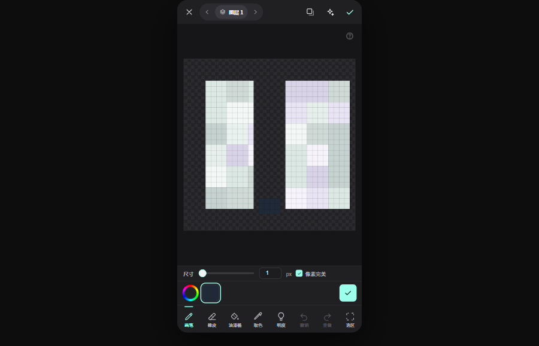
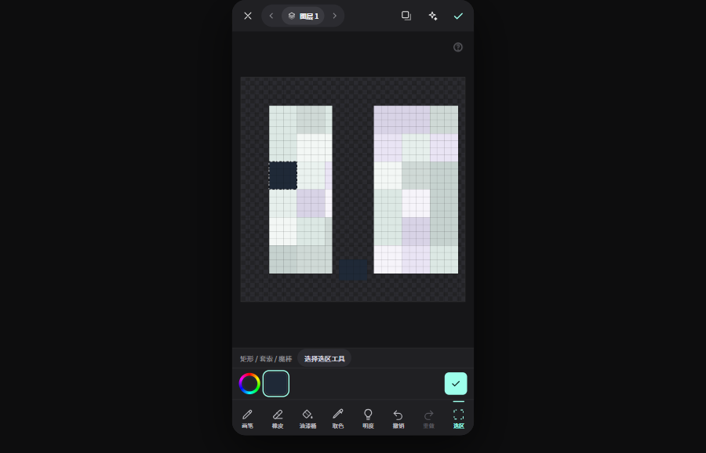

# Little Squirrel（小松鼠）


手机端像素 UV 贴图编辑器。在手机上画 1×1 ~ 1024×1024 的像素贴图：多图层与混合模式、选区、调色环、油漆桶、明度/饱和度笔刷、参考底图、网格，导出 PNG 或 `.uvproj` 工程。

**发行版本：`0.10_preview`**（versionCode 10，Android，debug 签名）

## 发行版本

| 版本 | 日期 | 类型 | versionCode | 产物 | 说明 |
|---|---|---|---|---|---|
| **0.10_preview** | 2026-11-26 | Preview | 10 | `apk/PixelUV-debug.apk`（4.34 MB） | 首个对外预览：多图层与混合模式、选区工具链、`.uvproj` 工程、自动保存、参考底图、网格、自适应图标与启动页 |
| 0.9 | 2026-11-26 | 内部构建 | — | 未发布 | 选区、手势、导出路径、网格外观 |
| 0.8 | 2026-11-26 | 内部构建 | — | 未发布 | 多图层文档与合成、图层文件夹、参考底图 |
| 0.7 | 2026-11-26 | 内部构建 | — | 未发布 | 深色 UI、自定义画布、色板、图层拖动 |

> 当前发行版：**0.10_preview**。安装包固定放在 `apk/PixelUV-debug.apk`，包名 `com.icanfly.pixeluv`，debug 签名，可直接覆盖安装。


## 功能

| 模块 | 能力 |
|---|---|
| 画布 | 1×1 ~ 1024×1024，可非正方形；视口渲染，缩放 0.1×~64× 只绘制可见区域 |
| 绘制 | 铅笔/橡皮 1~50px、油漆桶（阈值 + 连续/全局）、取色器（长按放大镜）、明度/饱和度笔刷、像素完美 |
| 图层 | 多图层、16 种混合模式、不透明度、显隐、锁定、透明锁、拖拽排序、文件夹分组、向下合并、重命名/清空 |
| 选区 | 矩形/椭圆/套索/魔棒、布尔运算、扩展收缩、蚂蚁线；移动/翻转/填充/清空/复制剪切粘贴、选区 HSL、剪切浮动链 |
| 颜色 | 色相环 + SV 方块、HSV / RGBA / HEX、色板自动记录（上限 64）、管理与清空 |
| 参考底图 | 导入 UV 展开图，显隐与透明度可调，不参与导出 |
| 网格 | 分隔线颜色可换；网络视图常亮青色、可设 1×1 ~ 32×32 网格尺寸 |
| 手势 | 双指缩放/平移、双指轻点撤销、三指轻点重做、长按取色、双击 100%/适应、长按第 8 槽切抓手 |
| 工程 | IndexedDB 即时落库 + 编辑中 1.2s 防抖自动保存；`.uvproj` 导入导出（JSON + base64 像素） |
| 导出 | 编辑页顶栏或图库长按，1× / 4× 最近邻；Android 写 `Documents/PixelUV/` 并调起分享 |
| 外观 | 深色 UI + 青色强调（`#9DFFEB`）、像素图标、自适应启动图标、深色启动页 |

## 截图






## 安装 APK

`apk/PixelUV-debug.apk`（4.34 MB）传到手机安装，或连接设备：

```powershell
& "C:\development\android-sdk\platform-tools\adb.exe" install -r apk\PixelUV-debug.apk
```

包名 `com.icanfly.pixeluv`，中文系统桌面显示「小松鼠」，其他语言显示「Little Squirrel」。

## 本地开发

```powershell
pnpm install
pnpm run dev        # http://127.0.0.1:5173
pnpm run build
```

Android 打包（需 JDK 21 + Android SDK）：

```powershell
$env:JAVA_HOME = "C:\development\jdk21"
$env:ANDROID_HOME = "C:\development\android-sdk"
node node_modules/@capacitor/cli/bin/capacitor sync android
cd android
C:\development\gradle-8.13\bin\gradle.bat :app:assembleDebug -I init-mirrors.gradle
```

产物：`android/app/build/outputs/apk/debug/app-debug.apk`，复制到 `apk/PixelUV-debug.apk`。

## 目录

```
src/
├─ core/        # 像素、图层、选区、导出、工程文件、IndexedDB
├─ components/  # CanvasStage、色环、图标
├─ screens/     # 图库、编辑、设置、抽屉面板
├─ state/       # zustand store
└─ styles/      # 深色 token 与组件样式
android/        # Capacitor 工程、图标与启动页
apk/            # 打包产物
docs/           # 预览图
项目文档.md      # PRD + 技术方案 + 验收清单
```

## 已知限制

- 选区 P1 未做：多边形套索、旋转 90°、系统剪贴板、魔棒按合成取样、浮动内容直接绘制
- 桶 / 魔棒 / 导出尚未 Worker 化，1024² × 多层的帧率未做真机压测
- Android 12+ 系统启动画面只显示图标，随后切到带名称的启动页
