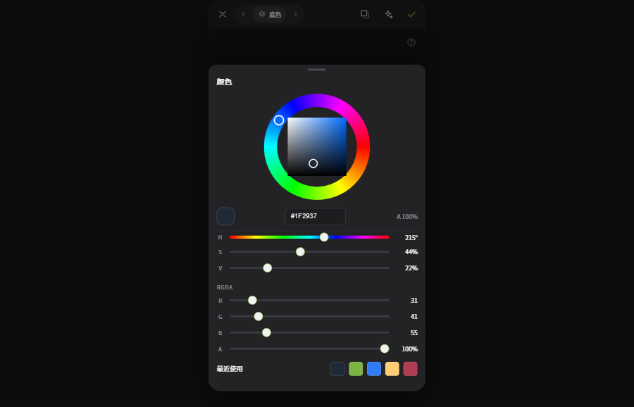
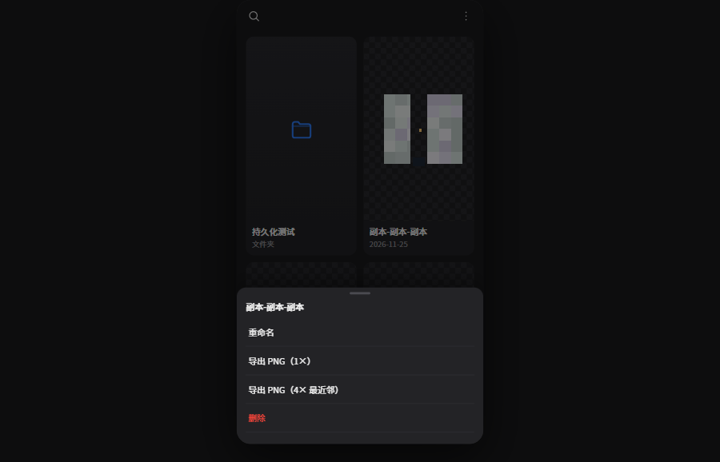

# PixelUV · 手机端像素 UV 贴图编辑器

在手机上绘制 32×32 ~ 1024×1024 的像素 UV 贴图：图层与混合模式、HSV/RGBA 调色、取色器、橡皮、油漆桶（带阈值）、噪点、套索/魔棒/选框、选区移动翻转复制粘贴与明度调整、撤销重做，导出 PNG。

## 当前进度（M0 已跑通）

| 屏幕 | 状态 |
|---|---|
| 贴图库 | 全深色 + 青色强调；两列 3:5 卡片；文件夹；搜索；排序；导入图片；新建文件/文件夹（宽高可自定义，新建为空白）；底部 创作 / ＋ / 设置 |
| 编辑页 | 深色顶栏（✕ / 图层切换 / 参考底图 / 效果 / ✓）、深灰画布、参数行、色板条、8 槽工具栏、抽屉面板 |
| 颜色 | 调色环（色相环 + SV 方块）+ HSV + RGBA + HEX；用色自动进色板（上限 64） |
| 画布 | 铅笔/橡皮（1~50px，可手填）、油漆桶、取色器、明度/饱和度笔刷；双指缩放 0.1×~64×；撤销/重做 |
| 持久化 | IndexedDB：工程、文件夹、像素改动即时落库，刷新/重开不丢 |
| Android | `apk/PixelUV-debug.apk`（4.2MB，minSdk 24 / target 36，debug 签名） |
| 导出 | 长按卡片 → 导出 PNG（1× / 4× 最近邻），直通 alpha |
| 面板 | 图层（拖拽排序、混合模式下拉）、选区（占位）、效果（噪点可应用）、帮助 |





## 安装 APK

`apk/PixelUV-debug.apk` 传到手机安装即可（需允许「安装未知来源应用」）；或连接设备后：

```powershell
& "C:\development\android-sdk\platform-tools\adb.exe" install -r apk\PixelUV-debug.apk
```

## 运行（Web / 开发）

```powershell
cd "C:\Users\21660\Desktop\ICanFly\UV绘制工具"
npm.cmd run dev
```

浏览器打开 http://127.0.0.1:5173/ 。手机同 Wi-Fi 访问用 `npm.cmd run dev -- --host`，打开终端显示的局域网地址。

```powershell
npm.cmd run typecheck   # tsc --noEmit
npm.cmd run build       # 产物在 dist/
```

## 构建 Android 包

```powershell
npm.cmd run build
node node_modules/@capacitor/cli/bin/capacitor sync android
$env:JAVA_HOME='C:\development\jdk21'
$env:ANDROID_HOME='C:\development\android-sdk'
cd android
C:\development\gradle-8.13\bin\gradle.bat :app:assembleDebug -I init-mirrors.gradle
```

工具链放在 `C:\development\`（不要放工作区：工作区里的 exe 写 `~/.gradle` 会被拒绝）。
细节与踩坑见[项目文档 11.6](项目文档.md)。

## 技术栈

- TypeScript 5.9 + Vite 8 + React 19 + Canvas 2D
- 状态：zustand ｜ 颜色：culori + 自绘调色环 ｜ 全深色主题
- 后续接入：Capacitor（Android）、fflate（`.uvproj`）、idb（IndexedDB）、magic-wand-js（魔棒算法）

## 目录

```
src/
  core/pixels.ts        像素缓冲、Bresenham、示例贴图生成
  components/           图标、画布、调色环、缩略图
  screens/              贴图库、编辑页、抽屉面板
  state/useApp.ts       工程/文件夹/路由/Sheet/Toast
  styles/app.css        设计 token 与全部样式
docs/                   项目文档、预览图
scripts/check-deps.mjs  依赖体检
```

## 里程碑

| 阶段 | 周期 | 目标 |
|---|---|---|
| M0 | 1 周 | 脚手架、设计系统 — **已完成（演示版）** |
| M1 | 3 周 | 像素引擎（脏矩形合成）、多图层、撤销栈 — 工程持久化与 PNG 导出已提前完成 |
| M2 | 3 周 | 混合模式、选区全家桶、油漆桶阈值、魔棒、明度/饱和度 |
| M3 | 2 周 | 噪点、自动保存、`.uvproj`、性能压测、Capacitor 打包 |
| M4 | 2 周 | 手势打磨、真机适配、上架 |

## 文档

- [项目文档（PRD + 技术方案 + 轮子调研 + 界面落地）](项目文档.md) — v0.7
- 界面参考：`界面参考/主界面参考.jpg`、`界面参考/编辑页参考.jpg`
