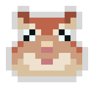
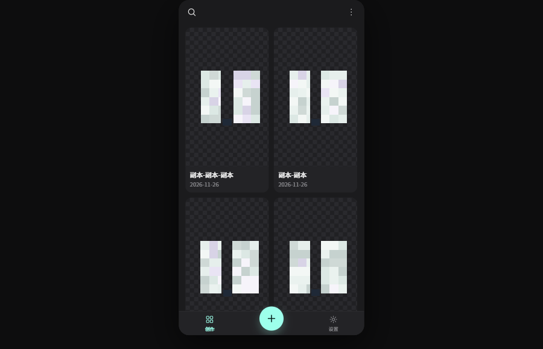
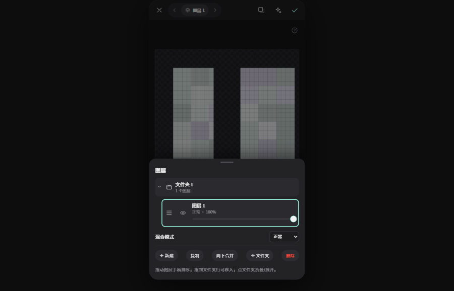

# Little Squirrel（小松鼠）



手机端像素绘制工具。在手机上画 1×1 ~ 1024×1024 的像素画/贴图：多图层与混合模式、选区、调色环、油漆桶、明度/饱和度笔刷、参考底图、网格，导出 PNG 或 `.uvproj` 工程。

**发行版本：`0.10`（候选正式版，versionCode 10，Android）**

## 发行版本

| 版本 | 日期 | 类型 | versionCode | 产物 | 说明 |
|---|---|---|---|---|---|
| **0.10** | 2026-11-27 | 正式版（已签名） | 10 | `apk/LittleSquirrel-0.10-release.apk`（3.18 MB） | 多图层与混合模式、完整选区工具链、`.uvproj`、自动保存、参考底图、网格、设置接线、Worker 化魔棒/导出 |
| 0.10_preview | 2026-11-26 | 预览 | 10 | 未发布 | 首个对外预览 |
| 0.9 | 2026-11-26 | 内部构建 | — | 未发布 | 选区、手势、导出路径、网格外观 |
| 0.8 | 2026-11-26 | 内部构建 | — | 未发布 | 多图层文档与合成、图层文件夹、参考底图 |
| 0.7 | 2026-11-26 | 内部构建 | — | 未发布 | 深色 UI、自定义画布、色板、图层拖动 |

> 当前发行版：**0.10_preview**。安装包固定放在 `apk/PixelUV-debug.apk`，包名 `com.icanfly.pixeluv`，debug 签名，可直接覆盖安装。


发布说明与发版检查：[docs/release-0.10.md](docs/release-0.10.md)

## 功能

| 模块 | 能力 |
|---|---|
| 画布 | 1×1 ~ 1024×1024，可非正方形；视口渲染，缩放 0.1×~64× 只绘制可见区域；编辑器内可改画布/图像尺寸，画布支持 3×3 锚点 |
| 绘制 | 铅笔/橡皮 1~50px、油漆桶（阈值 + 连续/全局 + 当前层/全部图层）、取色器（1×1/3×3 + 长按放大镜）、明度/饱和度笔刷、像素完美 |
| 图层 | 多图层、16 种混合模式、不透明度、显隐、锁定、透明锁、拖拽排序、文件夹分组、向下合并、重命名/清空 |
| 选区 | 矩形/椭圆/套索/魔棒、布尔运算、扩展收缩、蚂蚁线；移动/翻转/填充/清空/复制剪切粘贴、选区 HSL、剪切浮动链 |
| 颜色 | 色相环 + SV 方块、HSV / RGBA / HEX、色板自动记录（上限 64）、管理与清空 |
| 参考底图 | 导入任意参考图，显隐与透明度可调，不参与导出 |
| 网格 | 分隔线颜色可换；网络视图常亮青色、可设 1×1 ~ 32×32 网格尺寸 |
| 手势 | 双指缩放/平移、双指轻点撤销、三指轻点重做、长按取色、双击 100%/适应、长按第 8 槽切抓手 |
| 图库 | 拖动排序（自定义顺序）、拖入文件夹、卡片右下角 ⋮ 菜单 |
| 工程 | IndexedDB 即时落库 + 编辑中 1.2s 防抖自动保存；`.uvproj` 导入导出（JSON + base64 像素） |
| 导出 | 编辑页顶栏或图库长按，1× / 4× 最近邻；Android 写 `Documents/PixelUV/` 并调起分享 |
| 外观 | 深色 UI + 青色强调（`#9DFFEB`）、像素图标、自适应启动图标、深色启动页 |

## 截图






## 安装 APK

`apk/LittleSquirrel-0.10-release.apk`（3.18 MB，release 签名）传到手机安装，或连接设备：

```powershell
& "C:\development\android-sdk\platform-tools\adb.exe" install -r apk\PixelUV-debug.apk
```

包名 `com.icanfly.pixeluv`，中文系统桌面显示「小松鼠」，其他语言显示「Little Squirrel」。

## 本地开发

```powershell
pnpm install
pnpm run dev        # http://127.0.0.1:5173
pnpm run build
```

Android 打包（需 JDK 21 + Android SDK）：

```powershell
$env:JAVA_HOME = "C:\development\jdk21"
$env:ANDROID_HOME = "C:\development\android-sdk"
node node_modules/@capacitor/cli/bin/capacitor sync android
cd android
C:\development\gradle-8.13\bin\gradle.bat :app:assembleDebug -I init-mirrors.gradle
```

产物：`android/app/build/outputs/apk/debug/app-debug.apk`，复制到 `apk/PixelUV-debug.apk`。

## 目录

```
src/
├─ core/        # 像素、图层、选区、导出、工程文件、IndexedDB
├─ components/  # CanvasStage、色环、图标
├─ screens/     # 图库、编辑、设置、抽屉面板
├─ state/       # zustand store
└─ styles/      # 深色 token 与组件样式
android/        # Capacitor 工程、图标与启动页
apk/            # 打包产物
docs/           # 预览图
项目文档.md      # PRD + 技术方案 + 验收清单
```

## 已知限制

- 羽化未做（选区掩码仍是 0/1，需要整条绘制链改成 alpha 掩码）
- 多边形套索不支持双击闭合、回退上一点，只能点回起点
- 图层列表还没有缩略图；图层组不支持嵌套/组级混合
- 拖动排序只有源卡片放大，没有跟手浮层与落点高亮
- 系统剪贴板在部分 Android WebView 上可能被拒绝，失败会 Toast
- 未做 release 签名、隐私政策、首次引导、上架素材
- FPS 实测约 42（1024² 连续涂抹），达到 ≥30 的 M3 标准，未到 60
